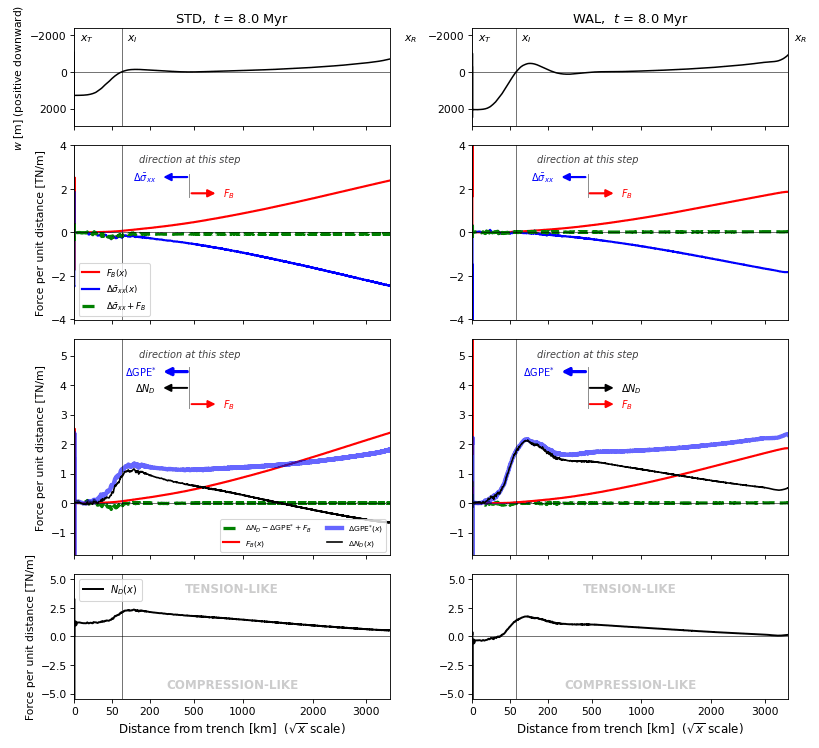

# trench_pull_fluidity

Analysis code for **"How topographic pressure gradients drive subducting plates"**
(Sandiford, submitted), which measures the plate-wide driving-force budget of
two free-subduction models directly from the vertical normal stress.

The models are the STD and WAL calculations of
[Cerpa et al. (2022)](https://doi.org/10.1029/2022JB024494); this repository
contains **no model code and no new simulations** — it post-processes their
published output. The companion data archive is
[Zenodo 6817177](https://zenodo.org/records/6817177).



> The force balance at every retained snapshot of both runs (STD left, WAL right,
> 8–80 Myr). Rows: the free surface; the fundamental form
> $\Delta\bar\sigma_{xx} + F_B = 0$; the decomposed form
> $\Delta N_D - \Delta\mathrm{GPE}^* + F_B = 0$ with its closure; and $N_D$ itself,
> which begins tension-like at the trench in STD and ends strongly compression-like.

---

## Start here

Everything below runs from this repository alone. The reference snapshot of both
runs is bundled in `data/`, and the reduced time-series caches are in
`notebooks/outputs/`, so **no download is needed to reproduce any figure in the
paper.**

```bash
conda env create -f environment.yml
conda activate pyvista-env
python -m ipykernel install --user --name pyvista-env   # register the kernel
```

Then either:

```bash
jupyter lab notebooks/01_single_timestep.ipynb   # the analysis, from one snapshot
python scripts/fig_column_anomalies_cumulative.py # any paper figure, ~1 s
```

**`notebooks/01_single_timestep.ipynb`** is the entry point. It derives the force
balance from the bundled snapshot, in the same steps the figure scripts use, and
is meant to be edited: the integration depth $z_c$, the column window and the
model are parameters at the top. It reproduces the content of four published
figures without being what makes them.

**`notebooks/02_time_evolution.ipynb`** does the same across all 37 retained
snapshots, reading the caches. It needs no model data at all.

---

## The mathematics

Everything in this repo is one **horizontal force balance**, post-processed from the model's stress fields. The balance is decomposed so that one term is the between-column difference of the vertically integrated vertical normal stress, $\Delta\bar\sigma_{zz} = -\Delta\mathrm{GPE}^*$ — and that term **is the pressure-gradient force**. This is the point of the exercise: topography links through to pressure gradients, and $\Delta\bar\sigma_{zz}$ is a consistent representation of the pressure-gradient force so long as the **true** vertical normal stress is used — which is exactly what a numerical model supplies, and exactly what solves static equilibrium. At depth the pressure gradients equilibrate: beneath **isostatic** topography by density differences, beneath **non-isostatic** topography (the trench) by vertical shear-stress gradients — which is where shear stresses couple in, and the only role the vertical integration plays. The notebooks are then a post-processing exercise in how much of the topography is translated into $\Delta\bar\sigma_{zz}$ — across the entire plate, because topography rises from the trench all the way to the ridge and provides a driving force the whole way along.

**Horizontal balance — driving the trailing plate.** Integrating $\partial_x \sigma_{xx} + \partial_z \sigma_{zx} = 0$ from surface to $z_c$ and from the trench column $x_T$ outward to a column at $x$ gives the trailing-plate balance

$$
\Delta N_D(x) - \Delta\mathrm{GPE}^{*}(x) + F_B(x) \approx 0
$$

with the three resultants

$$
N_D(x) = \int_0^{z_c} (\sigma_{xx} - \sigma_{zz})\,dz, \quad
\mathrm{GPE}^{*}(x) = -\int_0^{z_c} \sigma_{zz}\,dz, \quad
F_B(x) = \int_{x_T}^{x} \tau_{zx}(x', z_c)\,dx'
$$

and the **incremental** difference operator $\Delta f(x) \equiv f(x) - f(x_T)$ (a function of $x$; the manuscript's fixed $\Delta \equiv (\cdot)(x_I) - (\cdot)(x_T)$ is its value at $x = x_I$). $N_D$ measures whether the column is tension-like ($N_D > 0$) or compression-like ($N_D < 0$); $\mathrm{GPE}^{*}$ is minus the column-integrated vertical stress (positive for heavier columns); $F_B$ is the cumulative basal-shear traction integrated outward from the trench.

**Vertical structure — how the pressure gradients equilibrate at depth.** Integrating the vertical component of equilibrium downward from the surface decomposes the vertical normal stress into the two equilibration channels — density structure (lithostatic) and vertical shear-stress gradients (the shear function)

$$
-\sigma_{zz}(z) = \underbrace{\int_0^{z}\rho g\,d\xi}_{P_L(z)\ \text{lithostatic}} + \underbrace{\int_0^{z}\tau_{zx,x}\,d\xi}_{Q(z)\ \text{shear function}}
$$

The shear function evaluated at the compensation depth is the gradient of the vertical shear resultant, $Q(z_c) = dV/dx$ with $V(x) = \int_0^{z_c}\tau_{zx}\,dz$. Requiring every column to reach the same vertical normal stress at $z_c$ (hydrostatic at the compensation depth) gives the closure

$$
\frac{dV}{dx} = -(\rho_m - \rho_w)\,g\,w(x)
$$

— deflection $w$ positive downward, and $\rho_w = 0$ for the no-water Cerpa setup. The trench-pull figures test this empirically by overlaying $w(x)$ from the free-surface field against $w_\tau(x) = -\frac{1}{(\rho_m-\rho_w)\,g}\frac{dV}{dx}$.

*Sign bookkeeping.* The notebooks' code variable `V` is formed as $-\int\tau_{zx}^{\mathrm{extracted}}\,dz$; the extraction sign chain per model is specified in `MODEL.md`, and the plotted resultant is the $V$ of the equations above (positive at the trench, where the shear traction pulls the column down).

---

---

## Where every figure comes from

One script per figure, one figure per script, named alike. Each writes a CSV of
the numbers quoted in its caption, so a value in the paper can be traced to the
line of code that produced it.

This table is generated from the manuscript's own figure list by
`tools/update_readme_table.py`; run it with `--check` to confirm it is current.

| Paper | Figure file | Script | Numbers |
|---|---|---|---|
| Fig 1 | `figures/fig_headline_tracking.png` | `scripts/fig_headline_tracking.py` | `tables/headline_tracking.csv` |
| Fig 2 | `figures/fig_model_evolution.png` | `scripts/fig_model_evolution.py` | `tables/model_evolution.csv` |
| Fig 3 | `figures/fig_balance_snapshot_absolute.png` | `scripts/fig_balance_snapshot_absolute.py` | `tables/balance_snapshot_absolute.csv` |
| Fig 4 | `figures/fig_budget_time_detrended.png` | `scripts/fig_budget_time_detrended.py` | `tables/budget_time_detrended.csv` |
| Fig 5 | `figures/fig_column_anomalies_cumulative.png` | `scripts/fig_column_anomalies_cumulative.py` | `tables/column_anomalies_cumulative.csv` |
| Fig 6 | `figures/fig_mechanical_thickness.png` | `scripts/fig_mechanical_thickness.py` | `tables/mechanical_thickness.csv` |
| Fig 7 | `figures/fig_force_length_scale.png` | `scripts/fig_force_length_scale.py` | `tables/force_length_scale.csv` |
| Fig S1 | `ridge_trench_overview_v2.pdf` | — | — |
| Fig S2 | `figures/fig_stress_state.png` | `scripts/fig_stress_state.py` | `tables/stress_state.csv` |
| Fig S3 | `figures/fig_trench_resultants.png` | `scripts/fig_trench_resultants.py` | `tables/trench_resultants.csv` |
| Fig S4 | `figures/fig_slab_buoyancy.png` | `scripts/fig_slab_buoyancy.py` | `tables/slab_buoyancy.csv` |
| Fig S5 | `figures/fig_neutral_plane.png` | `scripts/fig_neutral_plane.py` | `tables/neutral_plane.csv` |
| Fig S6 | `figures/fig_trench_stress_profiles.png` | `scripts/fig_trench_stress_profiles.py` | `tables/bending_stress_regime.csv` |
| Fig S7 | `figures/fig_convergence.png` | `scripts/fig_convergence.py` | `tables/convergence.csv` |
| Fig S8 | `figures/fig_ridge_cumulative.png` | `scripts/fig_ridge_cumulative.py` | `tables/ridge_cumulative.csv` |
| Fig S9 | `figures/fig_thickness_definitions.png` | `scripts/fig_thickness_definitions.py` | `tables/thickness_definitions.csv` |
| Fig S10 | `figures/fig_balance_linear.png` | `scripts/fig_balance_linear.py` | `tables/balance_linear.csv` |
| Fig S11 | `figures/fig_gpe_partition.png` | `scripts/fig_gpe_partition.py` | `tables/gpe_partition.csv` |
| Fig S12 | `figures/fig_ridge_push_anatomy.png` | `scripts/fig_ridge_push_anatomy.py` | `tables/ridge_push_anatomy.csv` |
| Fig S13 | `figures/fig_ridge_density_check.png` | `scripts/fig_ridge_density_check.py` | `tables/ridge_density_check.csv` |
| Fig S14 | `figures/fig_tilt_velocity.png` | `scripts/fig_tilt_velocity.py` | `tables/tilt_velocity.csv` |

Figure 3 is a schematic, not produced here.

`figures/` contains exactly the figures the paper and its supplement use, and
nothing else.

---

## What is bundled, and what is not

| | |
|---|---|
| `data/` | the **t = 40 Myr reference snapshot of both runs**, redistributed from the Cerpa et al. archive under its licence (see `data/ATTRIBUTION.md`). This is what makes notebook 1 runnable. |
| `notebooks/outputs/*.npz` | reduced caches — column profiles, 2-D patches, slab geometry — for all 37 retained snapshots. These are what make the figure scripts fast. |
| not bundled | the full 1.4 GB archive: 41 snapshots per run. Fetch it from the Zenodo record above if you want to rebuild the caches or work at another epoch. |

The caches were produced on the author's machine by the builders in `scripts/`
(`column_profiles_cache.py`, `stress_section_cache.py`, …), which are included so
that anyone with the archive can rebuild and check them.

### If you want to rebuild a cache

Download the archive from the [Zenodo record](https://zenodo.org/records/6817177)
and unpack it so that `STD_RefModel/` and `WAL_RefModel/` — each a directory of
`subduction_with_LM*.pvtu` snapshots — sit inside one directory. Then point the
builders at it:

```bash
export TRENCH_PULL_DATA=/path/to/OUTPUTS
python scripts/column_profiles_cache.py     # first, ~20 min
python scripts/lab_kinematics_cache.py      # then the rest, in any order
```

`TRENCH_PULL_DATA` is the only path you need to set. If it is unset the builders
look in `~/DATA/numerical_models/OUTPUTS/`, which is the author's layout; if
neither is present they stop with a message rather than failing obscurely. The
build order matters only in that `column_profiles_cache.py` establishes the
trench, first-isostatic and ridge picks that the others read, so they share one
set of pickers.

**You do not need any of this to reproduce a figure in the paper.** Those render
from the committed caches and the bundled snapshot in `data/`, in seconds.

---

## Conventions

The analysis makes choices — an integration depth, a column window, how the
trench and ridge are picked — and they are declared rather than implied:

- **`docs/ANALYSIS_CONVENTIONS.md`** — how each quantity is measured, with the
  evidence for each choice and the deviations that remain open.
- **`docs/SYMBOLOGY.md`** — notation.
- **`MODEL.md`** — the raw-field map: which model field becomes which analysis
  quantity, and the sign chain between them.

Two worth knowing before reading any number:

- **$z_c = 80$ km**, the integration depth. Figure S6 shows what the choice costs.
- Analysis runs in the model's own orientation; figures are drawn with the trench
  at the left and seaward distance increasing rightward. Column integrals are
  unaffected by the reflection; $\tau_{zx}$, $v_x$ and $V$ change sign with it.

---

## Citing

If you use this code, please cite the paper and the Cerpa et al. model archive.
`CITATION.cff` carries the machine-readable form.

The model output is **not ours**. Any use of the data, including the two bundled
snapshots, should cite Cerpa et al. (2022) and the Zenodo record.

## Licence

This repository is CC BY 4.0, matching the licence of the model output it
analyses. See `LICENSE`; the bundled model output in `data/` carries its own, see `data/ATTRIBUTION.md`.
